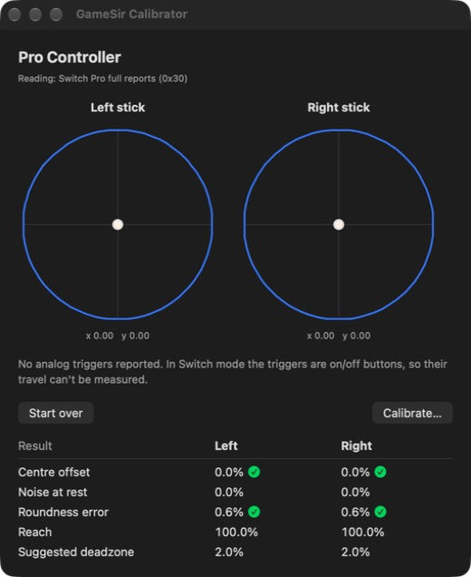

# GameSir Calibrator

Is your stick drifting, or is it just you? GameSir Calibrator is a small Mac app that shows you exactly how your controller's sticks behave, walks you through the controller's own calibration, and then measures again so you can see whether it helped.

It's free and open source. It's also unofficial: it isn't made by GameSir and isn't affiliated with them.



## Getting started

You'll need a Mac with macOS 14 or later (Apple Silicon or Intel).

1. Grab the latest `GameSirCalibrator-<version>.zip` from the [Releases page](https://github.com/AdhamSamer3301/GameSirCalibrator/releases/latest).
2. Unzip it and drag **GameSirCalibrator** into your **Applications** folder.
3. Open it.

### That "Apple could not verify…" popup

The first time you open the app, macOS will stop you with a popup saying it "could not verify GameSirCalibrator is free of malware". Don't worry, you only have to get past it once:

1. Click **Done** on the popup (not Move to Trash).
2. Open **System Settings → Privacy & Security** and scroll down to the **Security** section.
3. You'll see a note saying GameSirCalibrator was blocked. Click **Open Anyway**.
4. Confirm with your password or Touch ID, then click **Open Anyway** one more time.

That's it. From now on it opens like any other app. You'll see the popup once more each time you download a new version.

Comfortable with Terminal? This one line does the same job:

```bash
xattr -dr com.apple.quarantine /Applications/GameSirCalibrator.app
```

## Connecting your controller

Your Mac can only see the controller in **Switch mode**. Once it's connected, it shows up as "Pro Controller".

- **Cyclone 2 with the 2.4 GHz dongle:** plug the dongle into your Mac and press **Home + X**.
- **Bluetooth:** pair the controller in Switch mode (your manual has the button combo), then connect it from **System Settings → Bluetooth**.

Xbox mode won't work. macOS simply can't see controllers in that mode.

## How to use it

1. **Measure.** Click **Measure sticks** and keep your hands off for a couple of seconds. Then rotate both sticks around their edges a few times and click **Done**. You'll see where each stick rests, how much it jitters, how round its movement is, and a suggested deadzone.
2. **Calibrate.** Click **Calibrate…** and follow the steps. The calibration happens inside your controller and the app just guides you, so you don't need the GameSir app.
3. **Compare.** The app measures again and shows your before → after numbers side by side.

You can't break anything: the app only reads from your controller. It never changes its settings or how your games see it.

## Which controllers work?

| Controller | Mode | Connection | Calibration guide |
|---|---|---|---|
| GameSir Cyclone 2 | Switch (shows up as "Pro Controller") | 2.4 GHz dongle (Home + X) and Bluetooth, both tested | Step by step |
| Other controllers | Any mode your Mac sees as a gamepad | USB, dongle or Bluetooth | General tips for now |

One thing to know: in Switch mode the triggers work like simple buttons (pressed or not), so the app can't measure how far they travel.

## Help add your controller

Every controller has its own button combo for calibration. If yours isn't listed, you can add it in a few lines: copy the steps from your controller's manual into [`GameSirCalibrator/Guides.swift`](GameSirCalibrator/Guides.swift) and open a pull request. There are a few [beginner-friendly issues](https://github.com/AdhamSamer3301/GameSirCalibrator/issues?q=is%3Aissue+is%3Aopen+label%3A%22good+first+issue%22) waiting if you'd like a starting point.

Something not working? If a stick shows up on the wrong side, or not at all, please [open an issue](https://github.com/AdhamSamer3301/GameSirCalibrator/issues/new). Include the **Reading:** line shown under the controller name; it helps a lot.

## Building from source

You'll need Xcode 26 or later. Open `GameSirCalibrator.xcodeproj` and press Run, or build from Terminal:

```bash
xcodebuild -project GameSirCalibrator.xcodeproj -scheme GameSirCalibrator build
```

Run the tests by swapping `build` for `test`. For a universal build that runs on both Apple Silicon and Intel:

```bash
xcodebuild -project GameSirCalibrator.xcodeproj -scheme GameSirCalibrator -configuration Release -destination 'generic/platform=macOS' build
```

## Under the hood

For the curious: the app reads raw values straight from the controller through IOKit, because Apple's GameController framework smooths stick values before apps see them. Most controllers describe their own layout, so the app reads them directly. Switch-style controllers send their sticks as packed 12-bit values that their description leaves out, so the app decodes those bytes itself (`Gamepad.switchProSticks`). Steam Input adds a virtual copy of your controller, which the app ignores so each controller shows up once.

The maths lives in [`StickStats.swift`](GameSirCalibrator/StickStats.swift). The pass/fail thresholds are at the top of the file if you want to tweak them.

## License

MIT: free to use, change and share.
